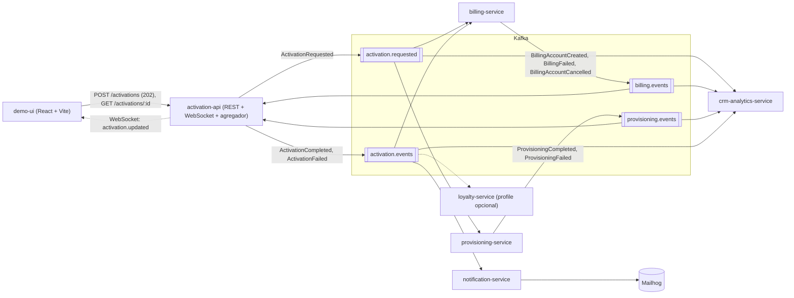
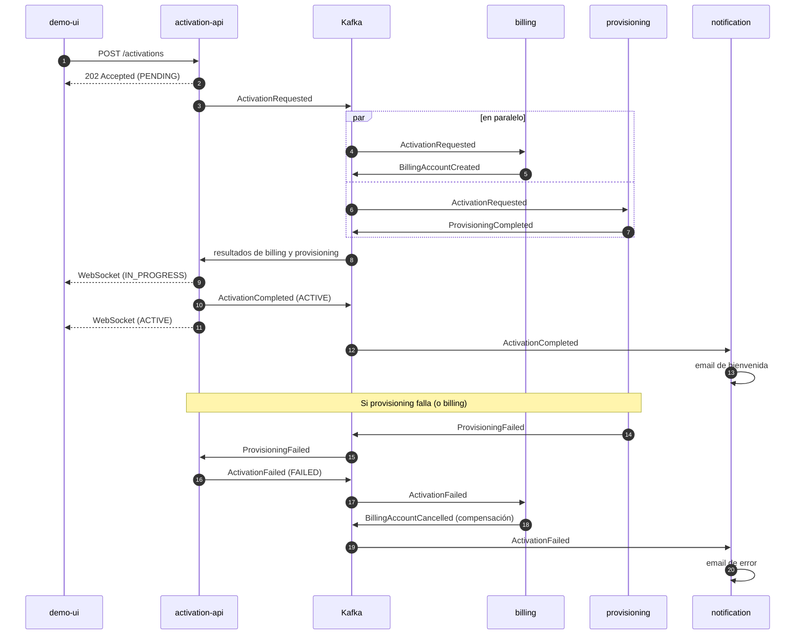
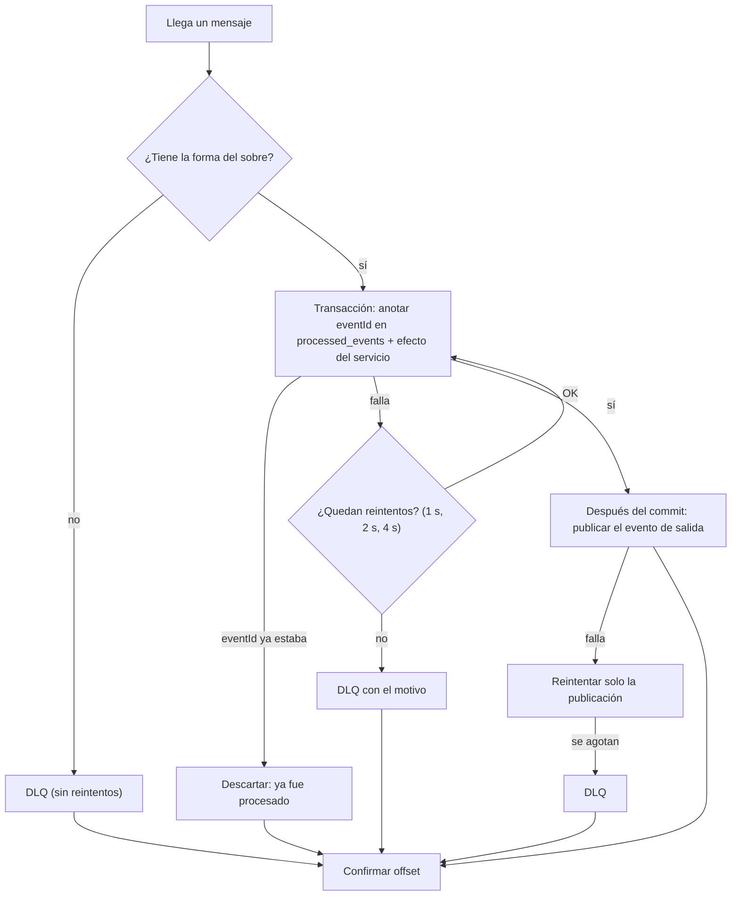

# Arquitectura de la POC: Activación de Servicios con Kafka

Este documento describe cómo está construida la POC y por qué. Sigue la estructura del PDF de la cátedra
(TP6) e indica, en cada punto, dónde difiere de él. La diferencia principal es que **la base de datos es
PostgreSQL y no MongoDB**.

- Cómo levantarla y demostrarla: [`demo-script.md`](demo-script.md)
- Contratos de eventos (única fuente de verdad): [`libs/contracts`](../libs/contracts/src)
- Idempotencia, reintentos y DLQ: [`libs/kafka-toolkit`](../libs/kafka-toolkit/src)

---

## 1. Idea general

Un cliente contrata un plan. Dos servicios independientes, **billing** (facturación) y **provisioning**
(aprovisionamiento), tienen que confirmar para que la activación quede `ACTIVE`. Si cualquiera falla, la
activación queda `FAILED` y billing **compensa**: anula la cuenta que haya creado.

Ningún servicio llama directamente a otro. Todos se comunican publicando y consumiendo **eventos** en Kafka.
Eso permite sumar un consumidor nuevo (crm-analytics, loyalty) sin tocar a los existentes.



---

## 2. Servicios

| Servicio | Rol | Entra | Sale | Base |
|---|---|---|---|---|
| `activation-api` | Recibe el pedido, agrega los resultados de la saga y avisa a la UI | HTTP, `billing.events`, `provisioning.events` | `activation.requested`, `activation.events`, WebSocket | `activation_db` |
| `billing-service` | Crea la cuenta de facturación y la anula si la activación falla | `activation.requested`, `activation.events` (solo `ActivationFailed`) | `billing.events` | `billing_db` |
| `provisioning-service` | Simula el aprovisionamiento (1 a 3 s) | `activation.requested` | `provisioning.events` | `provisioning_db` |
| `notification-service` | Envía el email de bienvenida o de error a Mailhog | `activation.events` | Email SMTP | `notification_db` |
| `crm-analytics-service` | Guarda una copia de todos los eventos. No publica nada | los 4 topics | nada | `crm_analytics_db` |
| `loyalty-service` | Suma puntos por cada activación completada (solo escenario 5) | `activation.events` | nada | `loyalty_db` |
| `demo-ui` | Formulario y línea de tiempo en vivo | HTTP + WebSocket | HTTP | n/a |

`loyalty-service` no figura en el árbol de carpetas del PDF, pero el escenario 5 de la demo lo requiere
(*"levantar un servicio loyalty con un group nuevo que lee desde el inicio"*). Va como `profile` de Compose:
no se levanta con un `up` normal.

---

## 3. Topics y consumer groups

Los 4 topics de negocio y sus DLQ (`<topic>.dlq`) tienen **3 particiones**, retención de **7 días** y
`customerId` como clave del mensaje. Los crea `docker/create-topics.sh` (la creación automática está
desactivada).

| Topic | Productor | Consumer groups |
|---|---|---|
| `activation.requested` | activation-api | `billing-svc`, `provisioning-svc`, `crm-analytics` |
| `billing.events` | billing | `activation-api`, `crm-analytics` |
| `provisioning.events` | provisioning | `activation-api`, `crm-analytics` |
| `activation.events` | activation-api | `notification-svc`, `billing-svc`, `crm-analytics`, `loyalty-svc` |
| `<topic>.dlq` | el consumidor que falló | inspección manual en Kafka UI |

Cada servicio tiene su **propio consumer group**. Por eso, un mismo evento llega a todos los grupos
interesados (*fan-out*), y las instancias de un mismo servicio comparten grupo y se reparten las
particiones (escenario 4).

> En Kafka UI los grupos aparecen con el sufijo `-server` (por ejemplo `billing-svc-server`). Lo agrega
> NestJS al crear el consumidor del microservicio. Es solo cosmético.

**Clave de partición = `customerId`.** Todos los eventos de un cliente caen en la misma partición y se
procesan en orden (RNF-02).

---

## 4. Contrato de eventos

Todos los eventos comparten el mismo sobre; solo cambia el payload. Los tipos viven en `libs/contracts`.

```json
{
  "eventId": "7c9e6679-7425-40de-944b-e07fc1f90ae7",
  "eventType": "ActivationRequested",
  "version": 1,
  "occurredAt": "2026-09-27T16:40:00Z",
  "correlationId": "act-0001",
  "customerId": "C-1234",
  "source": "activation-api",
  "payload": { "planId": "Plan Digital", "channel": "web", "simulateFailure": "none" }
}
```

| Campo | Uso |
|---|---|
| `eventId` | Identificador único. Base de la idempotencia. |
| `eventType` + `version` | Permiten evolucionar el contrato sin romper consumidores. |
| `correlationId` | Es el `activationId`. Agrupa todos los eventos de una activación. |
| `customerId` | También es la clave del mensaje en Kafka. |
| `source` | Servicio que publicó el evento. |

Eventos y payloads:

| Evento | Publica | Payload |
|---|---|---|
| `ActivationRequested` | activation-api | `planId`, `channel`, `simulateFailure` |
| `BillingAccountCreated` | billing | `billingAccountId` |
| `BillingFailed` | billing | `reason` |
| `BillingAccountCancelled` | billing | `billingAccountId`, `reason` |
| `ProvisioningCompleted` | provisioning | `provisioningOrderId` |
| `ProvisioningFailed` | provisioning | `reason` |
| `ActivationCompleted` | activation-api | (vacío) |
| `ActivationFailed` | activation-api | `failedStep` (`billing` o `provisioning`), `reason` |

El PDF solo define el payload de `ActivationRequested`; el resto es una propuesta mínima con lo que cada
servicio necesita.

Convenciones: eventos en pasado (describen un hecho), topics como `dominio.tipo`. Un cambio compatible suma
campos opcionales; uno incompatible sube `version`.

---

## 5. Flujos

### 5.1 Camino feliz y compensación



### 5.2 Estados de la activación

| Estado | Cuándo | Siguiente |
|---|---|---|
| `PENDING` | Al crear la activación | `IN_PROGRESS` |
| `IN_PROGRESS` | Llegó el primer resultado de billing o provisioning | `ACTIVE` o `FAILED` |
| `ACTIVE` | Billing y provisioning confirmaron | final |
| `FAILED` | Alguno de los dos falló | final (con compensación) |

### 5.3 Regla de agregación (activation-api)

`activation-api` guarda el resultado de cada servicio en la activación (`steps`).

- Con **los dos OK** publica `ActivationCompleted`.
- Con **el primer fallo** publica `ActivationFailed`. Los resultados posteriores de esa activación solo se
  anotan en el historial (`history`), no cambian el estado.
- Un resultado repetido de un servicio ya registrado se ignora.

La decisión es una función pura (`apps/activation-api/src/activations/aggregation.ts`), fácil de probar. Se
ejecuta dentro de la transacción del consumidor, con un bloqueo de fila (`pessimistic_write`): si llegan a
la vez el resultado de billing y el de provisioning, se procesan uno detrás del otro y no se pisan.

### 5.4 Caso borde: el fallo llega antes que la cuenta

Si provisioning falla antes de que billing termine de crear su cuenta, billing recibe `ActivationFailed`
primero. En ese caso deja una fila marcada `CANCELLED` para esa activación. Cuando después procesa el
`ActivationRequested` original, ve la marca y **no crea la cuenta**. La cuenta nunca queda activa.

---

## 6. Garantías de entrega

Kafka entrega "al menos una vez": un mensaje puede llegar repetido. La librería
`libs/kafka-toolkit` (clase `EventConsumer`) resuelve esto una sola vez, y los 6 servicios consumidores la
usan en todos sus handlers.



| Garantía | Cómo se logra |
|---|---|
| **Idempotencia** (RNF-03) | `processed_events` (clave primaria `eventId`) se escribe en **la misma transacción** que el efecto del servicio. O se aplican las dos cosas, o ninguna. Un evento repetido encuentra su `eventId` y se descarta. Los registros se borran a los 7 días (lo mismo que la retención de los topics). |
| **Reintentos** (RNF-04) | 3 reintentos con espera creciente (1 s, 2 s y 4 s), cada uno en una transacción nueva. Configurable con `RETRY_DELAYS_MS`. |
| **DLQ** (RNF-04) | Si sigue fallando, el mensaje **original** se publica en `<topic>.dlq`, con headers que explican el motivo: `x-error-message`, `x-error-attempts`, `x-failed-at`, `x-source-topic`, `x-source-partition`, `x-source-offset`, `x-consumer-group`. El resto de la partición sigue procesándose. Un mensaje mal formado va a la DLQ sin reintentos. |
| **Commit manual de offset** | El offset se confirma recién cuando el mensaje terminó: procesado, descartado por duplicado o enviado a la DLQ. Si el servicio se cae a mitad, Kafka reentrega el mensaje y la idempotencia evita el doble efecto. Si ni siquiera se puede publicar en la DLQ, el offset **no** se confirma. |
| **Reproceso** (RNF-05) | Los consumidores leen `fromBeginning`. Un servicio nuevo, o uno que estuvo caído, procesa todo lo pendiente. |
| **Trazabilidad** (RNF-06) | Todos los eventos llevan `correlationId`. `GET /activations/:id` devuelve el historial, y `crm-analytics` permite reconstruirlo con un solo `SELECT`. |

**Fallos de negocio no son fallos técnicos.** Que billing o provisioning "fallen a pedido"
(`simulateFailure`) es un resultado esperado: se publica como evento (`BillingFailed`,
`ProvisioningFailed`) y la saga lo compensa. La DLQ es solo para fallos que el código no puede resolver,
como la base caída o un mensaje inválido.

---

## 7. Modelo de datos (PostgreSQL)

Hay **una base por servicio**, todas dentro de la misma instancia de PostgreSQL. Ningún servicio lee la
base de otro. Las tablas se crean solas al arrancar (`synchronize: true`).

| Tabla | Base | Contenido | Índices |
|---|---|---|---|
| `activations` | activation_db | Estado, `steps` (resultado de cada servicio, jsonb) e `history` (jsonb) | PK `id` = activationId; `customerId` |
| `billing_accounts` | billing_db | Cuenta simulada por activación, `CREATED` o `CANCELLED` | `activationId` único |
| `provisioning_orders` | provisioning_db | Orden simulada de aprovisionamiento | `activationId` único |
| `notifications` | notification_db | Emails enviados (`PENDING` o `SENT`) | `activationId` + `eventType` único |
| `event_log` | crm_analytics_db | Copia de cada evento recibido, con topic, partición y offset | PK `eventId`; `correlationId`; `customerId` |
| `loyalty_accounts` | loyalty_db | Puntos por cliente | PK `customerId` |
| `processed_events` | todas las bases de consumidores | `eventId` ya procesados | PK `eventId`; `processedAt` |

**PostgreSQL en lugar de MongoDB.** El PDF modela la activación como un documento con `steps` e `history`
anidados. Se conservó esa forma con columnas `jsonb`: lo que se filtra (`id`, `customerId`, `status`) son
columnas normales y lo que solo se lee completo va como JSON. Una ventaja: PostgreSQL tiene transacciones
sin configuración extra. El PDF necesitaba un replica set de un nodo de Mongo solo para eso.

La variable `MONGO_URI` del PDF se reemplazó por `DATABASE_URL`.

---

## 8. Decisiones de diseño

| Decisión | Motivo |
|---|---|
| **Coreografía con agregador**, no orquestador | billing y provisioning reaccionan solos al evento; activation-api solo junta resultados. Es más simple que un orquestador que da órdenes y muestra mejor el desacople. |
| **Clave de partición = `customerId`** | Orden garantizado por cliente. |
| **Idempotencia en la misma transacción que el efecto** | Evita la ventana en que el efecto se aplica pero el `eventId` no se anota (o al revés). |
| **Commit de offset manual, después de procesar** | Nunca se marca como leído algo que no terminó. |
| **Trabajo posterior al commit (`AfterCommit`)** | La publicación del evento de salida se hace una vez confirmada la base y se reintenta por separado. |
| **Lógica de entrega en una librería compartida** | Idempotencia, reintentos y DLQ en un solo lugar, no repetidos en cada servicio. |
| **Contratos en una librería con versión** | `libs/contracts` es la única fuente de verdad de los eventos (RNF-07). |

---

## 9. Limitaciones conocidas

Esta es una POC. Estas son las limitaciones que conviene conocer y decir en la defensa:

1. **Falta el outbox.** Cada servicio publica en Kafka *después* de confirmar la base. Si el proceso se cae
   justo entre las dos cosas, el evento de salida se pierde. El PDF lo deja para la **fase 4**, que solo se
   hace si la POC avanza a piloto. El patrón consiste en guardar el evento en una tabla `outbox` dentro de
   la misma transacción y publicarlo desde allí.
2. **Posible email duplicado.** En `notification-service`, si el email se envía pero falla el commit de la
   base, el reintento lo vuelve a enviar. El envío de email no se puede deshacer con una transacción.
3. **Kafka sin volumen.** El contenedor de Kafka no guarda datos en disco: un `docker compose down` borra
   los topics (se recrean al volver a levantar). PostgreSQL sí tiene volumen.
4. **Esquema automático.** `synchronize: true` crea y modifica las tablas solo. Cómodo para una POC; en
   producción se usarían migraciones.
5. **WebSocket sin autenticación.** `activation.updated` se difunde a todos los clientes conectados. Alcanza
   para la demo.
6. **Un solo broker.** Con un broker no se puede mostrar la replicación. Un rebalanceo puede dar errores
   transitorios de coordinador que KafkaJS reintenta solo.

---

## 10. Trazabilidad con los requerimientos del PDF

| Requerimiento | Dónde se cumple |
|---|---|
| RF-01, RF-02 | `demo-ui` (formulario); `POST /activations` responde 202 con `PENDING` |
| RF-03 | `activation-api` publica `ActivationRequested` |
| RF-04 | billing y provisioning consumen el mismo evento, cada uno con su grupo |
| RF-05, RF-06 | Agregador en activation-api; compensación en billing |
| RF-07 | `notification-service` |
| RF-08 | WebSocket `activation.updated` + `demo-ui` |
| RF-09 | `GET /activations/:id` (estado, `steps` e `history`) |
| RF-10 | `crm-analytics-service` (`event_log`) y reproceso con reset de offsets |
| RNF-01 | `docker compose up -d --build` |
| RNF-02 | Clave de partición = `customerId` |
| RNF-03 | `processed_events` en la misma transacción |
| RNF-04 | 3 reintentos y DLQ en `EventConsumer` |
| RNF-05 | `fromBeginning` + commit manual de offsets |
| RNF-06 | `correlationId` en todos los eventos |
| RNF-07 | `libs/contracts` con campo `version` |

---

## 11. Estructura del repositorio

```
activation-poc/
├── apps/
│   ├── activation-api/            REST + WebSocket + agregador de la saga
│   ├── billing-service/
│   ├── provisioning-service/
│   ├── notification-service/
│   ├── crm-analytics-service/
│   ├── loyalty-service/           solo escenario 5 (profile "loyalty")
│   └── demo-ui/                   React + Vite + socket.io-client
├── libs/
│   ├── contracts/                 tipos de eventos, sobre común, nombres de topics
│   └── kafka-toolkit/             publicación y consumo con idempotencia, reintentos y DLQ
├── docker/
│   ├── create-topics.sh           crea los topics con 3 particiones
│   ├── init-databases.sql         crea una base por servicio
│   ├── Dockerfile.service         imagen de los servicios NestJS
│   └── Dockerfile.ui              imagen de la Demo UI
├── docker-compose.yml
└── docs/
    ├── architecture.md
    └── demo-script.md
```

Es un monorepo con `pnpm` workspaces (`apps/*` y `libs/*`).

### Puertos y accesos

| Qué | Dirección |
|---|---|
| Demo UI | http://localhost:5173 |
| activation-api | http://localhost:3000 |
| Kafka UI | http://localhost:8080 |
| Mailhog (emails) | http://localhost:8025 |
| Kafka (desde tu máquina) | `localhost:9092` |
| PostgreSQL (desde tu máquina) | `localhost:15432` (el 5432 suele estar ocupado por una instalación local) |

### Variables de entorno

| Variable | Qué es |
|---|---|
| `KAFKA_BROKERS` | Brokers de Kafka (`kafka:19092` dentro de Docker, `localhost:9092` fuera) |
| `KAFKA_CLIENT_ID`, `KAFKA_GROUP_ID` | Identidad y grupo del servicio |
| `DATABASE_URL` | Conexión a la base del servicio (reemplaza a `MONGO_URI`) |
| `CORS_ORIGIN` | Orígenes permitidos para la API y el WebSocket |
| `SMTP_HOST`, `SMTP_PORT` | Servidor de email (Mailhog) |
| `RETRY_DELAYS_MS` | Esperas entre reintentos, por ejemplo `1000,2000,4000` |
